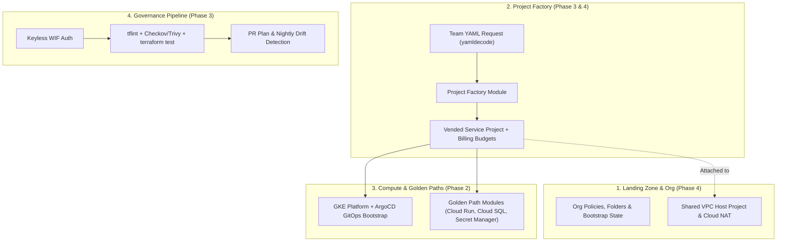

# 16-Week GCP Platform Engineering Terraform Master Plan (From Scratch)

This repository is your **blank-slate laboratory**. You will write every `.tf` file yourself from scratch, deploy to a real GCP project, intentionally break things ("Chaos Drills"), fix them, and evolve this repo into a production-grade **Internal Developer Platform (IDP)** on Google Cloud.

---

## DevOps vs. Platform Engineering Mindset
* **Traditional DevOps:** Writes Terraform to provision a resource when a developer opens a ticket.
* **Platform Engineer:** Uses Terraform to build **Golden Paths (Paved Roads)**, **Self-Service Project Factories**, **Shared Compute Platforms (GKE/Cloud Run)**, and **Automated Guardrails** so application teams can self-provision compliant infrastructure without waiting on tickets.



---

## Your Weekly Practice Loop (8–12 hrs/week)
For every week below, follow this **4-Step Loop**:
1. **Build (Blank File + Official Docs):** Put VS Code on the left half of your screen and the [Terraform Google Provider Docs](https://registry.terraform.io/providers/hashicorp/google/latest/docs) on the right. Write the HCL yourself from a blank file—no copy-pasting.
2. **Apply & Verify (Real GCP Project):** Run `terraform plan` and `terraform apply` against your GCP project. Verify resources via `gcloud` or the GCP Console.
3. **Chaos Drill (Break & Fix):** Complete that week's failure, drift, or state-surgery drill to build Senior Platform Engineer instincts.
4. **Teardown (`terraform destroy`):** Destroy billable compute/networking resources (Cloud NAT, GKE, VMs, Cloud SQL) at the end of your study session so your GCP bill stays near $0.

---

## Master Overview Table (16 Weeks)

| Phase | Week | Topic | What You Build from Scratch | Weekly Chaos Drill (Break & Fix) |
| :--- | :--- | :--- | :--- | :--- |
| **Phase 1: Foundations & Platform Mindset** | **Week 1** | **Bootstrap, ADC Auth & Core HCL** | `stages/00-bootstrap/`: `versions.tf`, `providers.tf`, enable core APIs (`google_project_service`), create Terraform Automation SA & versioned GCS State Bucket. | **ClickOps Drift Drill:** Manually edit a bucket label in GCP Console -> run `terraform plan` to detect drift -> `apply` to reconcile. |
| | **Week 2** | **Impersonation & Complex Data Types** | Refactor with `variables.tf` (`map(object)`, `optional()`), `locals`, `outputs.tf`, and configure `impersonate_service_account` so your laptop uses the Automation SA. | **Least-Privilege 403 Drill:** Try creating a `google_pubsub_topic` as the impersonated SA before granting IAM permissions; debug the raw 403 error. |
| | **Week 3** | **Layered Remote State & Blast Radius** | Add `backend "gcs"` to `00-bootstrap` (`terraform init -migrate-state`) and create isolated stage directories (`01-networking`, `02-platform-shared`, `03-workloads`). | **State Lock Drill:** Inspect state with `terraform state list`/`show` and test GCS state locking & `force-unlock`. |
| | **Week 4** | **Enterprise VPC & Private Connectivity** | `stages/01-networking/`: Custom VPC, regional subnets (`for_each`) with `gke-pods` & `gke-services` secondary CIDRs, Cloud Router, Cloud NAT, and Private Service Access. | **The `count` vs. `for_each` Trap:** Build 3 subnets with `count`, remove index `[0]`, watch Terraform try to recreate the rest, then fix with `for_each`. |
| **Phase 2: Golden Paths & Compute Platforms** | **Week 5** | **Authoring "Golden Path" Modules** | `modules/golden-path-microservice/`: Opinionated Cloud Run v2 module taking 5 simple inputs, enforcing FinOps labels, and validating rules via `validation` & `precondition` blocks. | **App vs. Infra CI/CD Conflict:** Update the Cloud Run image tag via `gcloud` -> watch `terraform plan` try to revert it -> fix with `lifecycle { ignore_changes }`. |
| | **Week 6** | **Identity Fabric & Least-Privilege IAM** | Extend Golden Path module to provision a dedicated Workload SA (`google_service_account`), `google_secret_manager_secret` (`for_each`), and additive IAM (`_iam_member`). | **Authoritative IAM Trap:** Compare `_iam_policy` vs. `_iam_binding` vs. `_iam_member` on a test secret to see how `_binding` wipes out existing access. |
| | **Week 7** | **The GKE Compute Platform Layer** | `stages/02-gke-platform/`: Read VPC outputs via `terraform_remote_state` and provision a private GKE Autopilot/Standard cluster with Workload Identity & Fleet registration. | **Immutable Fields Drill:** Change a subnet CIDR in code while attached to resources and learn to spot dangerous `-/+ destroy and recreate` plans. |
| | **Week 8** | **The Terraform-to-GitOps Handoff** | Use `helm` and `kubernetes` providers (authenticated via `data "google_client_config"`) to bootstrap **ArgoCD**, External Secrets Operator, and Config Connector onto GKE. | **Workload Identity Binding Drill:** Bind a Kubernetes Service Account (`ksa`) directly to a GCP Service Account (`gsa`) with zero keys. |
| **Phase 3: Self-Service, Testing & Guardrails** | **Week 9** | **YAML-Driven Self-Service (`yamldecode`)** | `stages/03-self-service-workloads/`: Use `fileset()` + `yamldecode()` so app teams just drop a 10-line `.yaml` file into `requests/` to get a full microservice stack. | **Guardrail Rejection Drill:** Submit a YAML with `environment: prod` and `max_instances: 1` and verify your module validation blocks reject it cleanly. |
| | **Week 10** | **PR Automation & Keyless WIF CI/CD** | Configure **Workload Identity Federation** (`google_iam_workload_identity_pool` + GitHub OIDC provider) and GitHub Actions / Atlantis to post `terraform plan` on PRs. | **Untrusted OIDC Claim Drill:** Verify WIF attribute conditions block token requests from unauthorized branches or repos. |
| | **Week 11** | **Module Testing & Policy-as-Code** | Write native `terraform test` suites (`.tftest.hcl` with `mock_provider "google"` + live integration tests) and add `tflint`, `trivy`/`checkov`, and `gcloud beta terraform vet`. | **Security Gate Drill:** Intentionally add a `0.0.0.0/0` SSH rule or public bucket and verify Checkov/Trivy fails the PR pipeline. |
| | **Week 12** | **State Surgery, Brownfield Imports & Drift** | Master declarative `moved {}` blocks, `import {}` blocks (`-generate-config-out`), `removed {}` blocks, and build a nightly scheduled drift-detection workflow. | **Rename Without Deleting Drill:** Rename a stateful resource block in code and use a `moved {}` block so `terraform plan` shows `0 to destroy`. |
| **Phase 4: Enterprise Landing Zones & IDP** | **Week 13** | **Resource Hierarchy & Org Policies** | `stages/04-org-governance/`: Manage GCP Folders (`google_folder`) and Organization Policies (`constraints/iam.disableServiceAccountKeyCreation`, external IP restrictions). | **Policy Enforcement Drill:** Attempt to create a Service Account JSON key after applying the Org Policy constraint. |
| | **Week 14** | **Project Factory & Shared VPC** | `modules/project-factory/`: Automate project creation (`google_project`), Billing Budget Alerts (`google_billing_budget`), API activation, and Shared VPC Service Project attachment. | **Cross-Project Subnet Isolation Drill:** Verify Service Project A's Service Account can only deploy into its assigned Shared VPC subnet. |
| | **Week 15** | **Platform Observability & Central Security** | `stages/05-observability/`: Provision centralized audit log sinks (`google_logging_project_sink` / `organization_sink`), Cloud Monitoring Uptime Checks, SLOs, and Alert Policies. | **Alert Trigger Drill:** Deploy a broken endpoint and verify your Terraform-provisioned Cloud Monitoring alert policy fires. |
| | **Week 16** | **Google FAST Deep-Dive & IDP Integration** | Benchmark your repo against Google's official **[Cloud Foundation Fabric (FAST)](https://github.com/GoogleCloudPlatform/cloud-foundation-fabric/tree/master/fast)** and wire a GitHub IssueOps / Backstage template to open YAML PRs automatically. | **Full End-to-End Platform Drill:** Provision a brand-new microservice from a YAML PR through WIF CI/CD with zero manual clicks. |

---

## Detailed Week-by-Week Checklists

### Phase 1: HCL Foundations & The "Platform Mindset" (Weeks 1–4)

#### Week 1: Local Workflow, ADC & Your First Bootstrap Resources
- [ ] Install `terraform` and `gcloud` CLI.
- [ ] Run `gcloud auth application-default login` (never download Service Account JSON keys!).
- [ ] Create `stages/00-bootstrap/versions.tf` and `providers.tf` pinning Terraform `>= 1.7.0` and `hashicorp/google` `~> 6.0`.
- [ ] Create `stages/00-bootstrap/main.tf` from scratch:
  - [ ] Enable core APIs (`cloudresourcemanager`, `iam`, `iamcredentials`, `sts`, `serviceusage`, `compute`, `run`, `secretmanager`) using `google_project_service` and `for_each` (with `disable_on_destroy = false`).
  - [ ] Create the platform automation service account (`google_service_account`).
  - [ ] Create a versioned GCS bucket (`google_storage_bucket`) for Terraform remote state with `uniform_bucket_level_access = true` and `public_access_prevention = "enforced"`.
- [ ] Run `terraform init`, `terraform plan`, and `terraform apply` against your GCP project.
- [ ] **Chaos Drill #1:** Manually add a label to the GCS bucket in the GCP Console, run `terraform plan` to see drift detection, and run `terraform apply` to revert the manual change.

#### Week 2: Service Account Impersonation & Data Structures for Platform Abstractions
- [ ] Grant your personal Google user `roles/iam.serviceAccountTokenCreator` on your Terraform Automation SA, and grant the Automation SA the roles needed to manage your project.
- [ ] Configure `impersonate_service_account` in `stages/00-bootstrap/providers.tf` so local commands run with the exact same identity your CI/CD pipeline will use.
- [ ] Refactor hardcoded values into `variables.tf`, `locals`, and `outputs.tf`.
- [ ] Practice complex types: `map(object({...}))`, `optional()` attributes with defaults, `for_each`, `for` expressions, `merge()`, and `flatten()`.
- [ ] **Chaos Drill #2:** Try creating a resource the impersonated SA doesn't have IAM permissions for yet, read the `Error 403` message, and grant the least-privilege IAM role in code.

#### Week 3: Multi-Layered Remote State & Blast Radius
- [ ] Add a `backend "gcs" {}` block to `stages/00-bootstrap/providers.tf` pointing to the state bucket from Week 1.
- [ ] Run `terraform init -migrate-state` to move local state to GCS, then delete local `.tfstate` files.
- [ ] Create the directory structure for layered state isolation: `stages/01-networking/`, `stages/02-gke-platform/`, `stages/03-self-service-workloads/`.
- [ ] **Chaos Drill #3:** Practice inspecting state with `terraform state list` and `terraform state show`, and learn how state locking works.

#### Week 4: Enterprise VPC & Private Connectivity
- [ ] In `stages/01-networking/`, write a custom-mode VPC (`google_compute_network` with `auto_create_subnetworks = false`).
- [ ] Provision regional subnets (`google_compute_subnetwork`) using `for_each` over a `map(object)` variable, including `secondary_ip_range` blocks for `gke-pods` and `gke-services` and `private_ip_google_access = true`.
- [ ] Provision `google_compute_router` and `google_compute_router_nat`.
- [ ] Expose `vpc_id` and `subnet_ids` in `outputs.tf`.
- [ ] **Chaos Drill #4:** Test `count` vs. `for_each` by removing the first element of a list and observing the index-shift destruction plan.
- [ ] **Teardown:** Destroy the Cloud NAT gateway at the end of your session to avoid hourly charges.

---

### Phase 2: Golden Path Modules & Compute Platforms (Weeks 5–8)

#### Week 5: Authoring "Golden Path" Modules
- [ ] Create `modules/golden-path-microservice/` (`versions.tf`, `variables.tf`, `main.tf`, `outputs.tf`).
- [ ] Design a clean `service_config` object input (`name`, `team`, `environment`, plus `optional()` sizing/scaling parameters).
- [ ] Add input `validation {}` blocks and resource `lifecycle { precondition {} }` blocks to enforce platform standards (e.g., `prod` requires `max_instances >= 2` and `deletion_protection = true`).
- [ ] Enforce mandatory FinOps labels (`managed_by`, `team`, `environment`, `service`) on all resources via `locals`.
- [ ] **Chaos Drill #5:** Update the deployed Cloud Run container image via `gcloud`, observe `terraform plan` trying to roll it back, and fix it with `lifecycle { ignore_changes = [template[0].containers[0].image] }`.

#### Week 6: Identity Fabric & Least-Privilege IAM
- [ ] Inside `modules/golden-path-microservice/`, create a dedicated `google_service_account` per microservice.
- [ ] Create `google_secret_manager_secret` resources using `for_each` over `var.service_config.secrets`.
- [ ] Bind the microservice's Service Account to its secrets using `google_secret_manager_secret_iam_member` (additive, non-authoritative).
- [ ] Practice **IAM Conditions** (e.g., prefix-based or time-based access).
- [ ] **Chaos Drill #6:** Test `_iam_binding` vs. `_iam_member` on a test resource to see how `_binding` overwrites existing role members.

#### Week 7: The GKE Platform Layer
- [ ] In `stages/02-gke-platform/`, reference your VPC and subnet outputs from `stages/01-networking/` via `data "terraform_remote_state"`.
- [ ] Provision a private GKE Autopilot (or Standard) cluster (`google_container_cluster`) using the `gke-pods` and `gke-services` secondary ranges, release channels (`REGULAR`), and Workload Identity enabled.
- [ ] Register the cluster to a GKE Fleet (`google_gke_hub_membership`).
- [ ] **Chaos Drill #7:** Test changing an immutable field (like subnet CIDR) in `terraform plan` to see how cascading replacements look.
- [ ] **Teardown:** Run `terraform destroy` on the GKE stage after each study session!

#### Week 8: The "Terraform-to-GitOps Handoff"
- [ ] Configure the `kubernetes` and `helm` providers dynamically using `data "google_client_config"` and the GKE cluster endpoint.
- [ ] Bootstrap **ArgoCD** and **External Secrets Operator** via `helm_release` so Terraform sets up the cluster platform and hands off app delivery to GitOps.
- [ ] **Chaos Drill #8:** Bind a Kubernetes Service Account (`ksa`) to a GCP Service Account (`gsa`) using GKE Workload Identity Federation (zero JSON keys).

---

### Phase 3: Self-Service Automation, Testing & Guardrails (Weeks 9–12)

#### Week 9: YAML-Driven Self-Service (`yamldecode` Pattern)
- [ ] In `stages/03-self-service-workloads/`, create a `requests/` directory with developer YAML files (`payments-api.yaml`, `orders-worker.yaml`).
- [ ] Use `fileset("${path.module}/requests", "*.yaml")` and `yamldecode(file(...))` in `main.tf` to dynamically invoke `modules/golden-path-microservice` via `for_each`.
- [ ] **Chaos Drill #9:** Put invalid configuration in a YAML file and verify your module's `validation` blocks stop the plan with a clear error message.

#### Week 10: PR-Driven Automation (GitHub Actions / Atlantis + WIF)
- [ ] In `stages/00-bootstrap/`, create a `google_iam_workload_identity_pool` and `google_iam_workload_identity_pool_provider` for GitHub OIDC (`https://token.actions.githubusercontent.com`).
- [ ] Bind your GitHub repository to the Terraform Automation SA via `roles/iam.workloadIdentityUser`.
- [ ] Create `.github/workflows/terraform.yml` to authenticate keyless via WIF, run `plan` on PRs, post the plan diff as a PR comment, and run `apply` on merge to `main`.
- [ ] **Chaos Drill #10:** Test WIF `attribute_condition` restrictions so only your repository/org can assume the Service Account.

#### Week 11: Module Testing & Policy-as-Code Guardrails
- [ ] Create `modules/golden-path-microservice/tests/unit.tftest.hcl` using `mock_provider "google" {}` to test valid plans (`assert {}`) and expected guardrail failures (`expect_failures = [...]`).
- [ ] Create `integration.tftest.hcl` to test real `apply`/`destroy` lifecycle on GCP.
- [ ] Add `tflint` (with `tflint-ruleset-google`), `trivy config .` (or `checkov`), and `gcloud beta terraform vet` to your GitHub Actions pipeline.
- [ ] **Chaos Drill #11:** Open a PR with a public bucket or `0.0.0.0/0` SSH firewall rule and verify your CI security gates block the PR.

#### Week 12: State Surgery, Brownfield Migration & Drift Detection
- [ ] **Drill A (`moved`):** Refactor/rename a resource inside `modules/golden-path-microservice` and add a `moved {}` block so existing services aren't destroyed.
- [ ] **Drill B (`import`):** Create a Pub/Sub topic manually in the GCP Console, write an `import {}` block, and use `terraform plan -generate-config-out=imported.tf` to adopt it cleanly.
- [ ] **Drill C (`removed`):** Use a `removed {}` block to detach a resource from Terraform state without deleting it in GCP.
- [ ] **Drill D (Scheduled Drift Detection):** Add a nightly scheduled GitHub Action running `terraform plan -detailed-exitcode` to alert on manual ClickOps changes.

---

### Phase 4: Enterprise Landing Zone & Internal Developer Platform (Weeks 13–16)

#### Week 13: GCP Resource Hierarchy & Organization Policies
- [ ] Learn how to manage `google_folder` hierarchies (`Production`, `Non-Production`, `Sandbox`, `Shared-Platform`) and `google_org_policy_policy` constraints (`constraints/iam.disableServiceAccountKeyCreation`, `constraints/compute.vmExternalIpAccess`, `constraints/gcp.resourceLocations`).

#### Week 14: Building a "Project Factory" & Shared VPC
- [ ] Build `modules/project-factory/` to vend isolated environments/projects, attach billing, configure **Cloud Billing Budget Alerts** (`google_billing_budget`), enable baseline APIs, and attach Service Projects to a **Shared VPC Host Project** (`google_compute_shared_vpc_host_project` / `service_project`) with subnet-level `roles/compute.networkUser` IAM bindings.

#### Week 15: Platform Observability & Centralized Security
- [ ] Build `stages/05-observability/` to provision centralized audit log sinks (`google_logging_project_sink` / `organization_sink` to BigQuery/GCS), Cloud Monitoring Uptime Checks, Alert Policies (`google_monitoring_alert_policy`), and SLOs as code.

#### Week 16: Deep-Dive into Google Cloud Foundation Fabric (FAST) & IDP Integration
- [ ] Study Google's official enterprise reference architecture: **[Cloud Foundation Fabric FAST](https://github.com/GoogleCloudPlatform/cloud-foundation-fabric/tree/master/fast)** (`0-bootstrap`, `1-resman`, `2-networking`, `3-project-factory`).
- [ ] Connect your YAML-driven self-service folder to a GitHub Issue Form workflow or Backstage.io software template so filling out a web form automatically opens a PR in your repo.

---

## Golden Rules to Practice from Day 1
1. **Never use Service Account JSON keys:** Always use Application Default Credentials locally (with `impersonate_service_account`) and Workload Identity Federation in CI/CD.
2. **Pin all versions:** Always pin `required_version` for Terraform, `version` for `hashicorp/google` and `hashicorp/google-beta`, and tag versions on all external modules.
3. **Separate Infrastructure from Application Deployment:** Use `lifecycle { ignore_changes = [template[0].containers[0].image] }` on Cloud Run / GKE workloads so app CI/CD and infra CI/CD don't fight each other.
4. **Always read the Plan:** Treat `terraform plan` output like a database migration review—especially watching for `-/+ destroy and then create replacement` on stateful resources.

---

## Week 1, Assignment #1 (Start Here!)

1. Install Terraform on your Mac:
   ```bash
   brew tap hashicorp/tap
   brew install hashicorp/tap/terraform
   ```
2. Authenticate locally to your GCP project:
   ```bash
   gcloud auth login
   gcloud auth application-default login
   ```
3. Create `stages/00-bootstrap/main.tf` from scratch using the [Terraform Google Provider Docs](https://registry.terraform.io/providers/hashicorp/google/latest/docs):
   - Configure the `hashicorp/google` provider (`~> 6.0`) for your GCP Project ID and region.
   - Create a versioned `google_storage_bucket` with `uniform_bucket_level_access = true` and `public_access_prevention = "enforced"` to hold your future Terraform state.
   - Create a `google_service_account` (`tf-platform-automation`).
